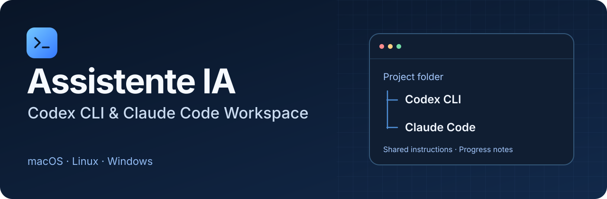

# Espacio de trabajo para Codex CLI y Claude Code



**Assistente IA** es un panel de escritorio ligero para Codex CLI y Claude Code en macOS, Linux y Windows. Elige un proyecto y un agente en el panel. La sesión se abre en el terminal del sistema, en la carpeta seleccionada. Ambos agentes pueden compartir instrucciones, solicitudes reutilizables y notas de progreso.

[](https://github.com/Anglersondev/Codex-CLI-Claude-Code-Workspace/releases/latest) [](LICENSE)

**[Descargar la última versión](https://github.com/Anglersondev/Codex-CLI-Claude-Code-Workspace/releases/latest)** · [English](README.md) · [Português (Brasil)](README.pt-BR.md) · [Historial de versiones](CHANGELOG.md)

[Instalación](#descargar-e-instalar) · [Primer proyecto](#trabajar-con-un-proyecto) · [Contexto compartido](#contexto-compartido-y-progreso)

## Descargar e instalar

| Sistema | Descarga | Cómo abrir |
| --- | --- | --- |
| **macOS** | [Assistente IA para Mac](https://github.com/Anglersondev/Codex-CLI-Claude-Code-Workspace/releases/latest/download/Assistente-IA-App-macOS.zip) | macOS 13 o posterior. Extrae el ZIP y abre `Assistente IA.app`. |
| **Linux** | [Assistente IA para Linux](https://github.com/Anglersondev/Codex-CLI-Claude-Code-Workspace/releases/latest/download/Assistente-IA-App-Linux.zip) | Instala Python 3.9+, Tkinter y un terminal gráfico. En la carpeta extraída, ejecuta `sh ASSISTENTE-IA-LINUX-GUI.sh`. |
| **Windows** | [Assistente IA para Windows](https://github.com/Anglersondev/Codex-CLI-Claude-Code-Workspace/releases/latest/download/Assistente-IA-App-Windows.zip) | Instala Python 3.9+ con Tcl/Tk. Extrae el ZIP y abre `ASSISTENTE-IA-WINDOWS-GUI.cmd`. |
| **Código fuente** | [ZIP del código fuente](https://github.com/Anglersondev/Codex-CLI-Claude-Code-Workspace/releases/latest/download/Assistente-IA-Source.zip) | Incluye lanzadores, código, pruebas y licencia MIT. |

Instala [Codex CLI](https://learn.chatgpt.com/docs/cli) o [Claude Code](https://code.claude.com/docs/en/setup) e inicia sesión. La descarga de macOS tiene una firma ad hoc. Si el sistema bloquea la app, puedes usar el lanzador de terminal o [compilarla localmente](README.md#build-and-verify-from-source).

## Trabajar con un proyecto

1. Usa **Carpeta predeterminada** para elegir dónde guardar los proyectos nuevos.
2. Pulsa **Nuevo**, elige el primer agente y decide la organización. **Separar por agente** usa `CODEX/` o `CLAUDE/`. **Crear directamente en la carpeta elegida** crea solo la carpeta del proyecto. Usa **Abrir** para proyectos existentes.
3. Selecciona **Nueva sesión**, **Continuar** o **Historial**. Trabaja en el terminal y vuelve al panel al terminar.
4. En **Ajustes → Idioma**, elige español, inglés, portugués de Brasil o **Automático**.

Usa **Agente de esta sesión** para alternar entre Codex y Claude en el mismo proyecto. La organización solo define dónde se crea el proyecto. Al seleccionar el otro agente, el panel abre un checkpoint para que lo revises.

`AGENTS.md` y `CLAUDE.md` apuntan a `INSTRUCCIONES/PROYECTO.md` en los proyectos organizados. Usa ese archivo para compartir reglas y objetivos. Guarda decisiones y el próximo paso en `DOCUMENTOS/PROGRESO.md`. Al cambiar de agente o cuenta, **Continuar desde las notas del proyecto** abre una sesión nueva con ese resumen. Cada agente conserva su propio historial.

El panel reúne solicitudes guardadas, archivos adjuntos, estado de Git, servidor npm, copias ZIP y acceso a la terminal. Los menús de terminal siguen disponibles en los lanzadores de cada sistema. Consulta la [guía para Linux y Windows](desktop/LEIA-ME.md) o la [documentación completa](README.md).

## Diagnóstico, cambio de agente y sesiones paralelas

| Quiero… | Dónde ir | Qué ocurre |
|---|---|---|
| Comprobar las herramientas | **Ajustes → Diagnóstico del entorno** | Muestra las versiones de Codex CLI, Claude Code, Git, npm y RTK, comprueba el inicio de sesión y sugiere cómo resolver los fallos. Para Token Optimizer muestra la configuración de cada agente y la versión encontrada en la caché. |
| Pasar una tarea de un agente al otro | **Agente de esta sesión → el otro agente** | Revisa los archivos modificados, anota las pruebas que ejecutaste e indica el próximo paso. **Guardar y abrir agente** añade el checkpoint a `DOCUMENTOS/PROGRESO.md` y abre el otro agente en esa carpeta con la petición de leerlo. **Solo guardar** registra el checkpoint y mantiene el agente actual. **Solo seleccionar agente** permite cambiar sin guardar. |
| Trabajar con ambos a la vez | Desde la raíz del repositorio, **Sesión aislada…** | Elige el agente y un nombre corto para la tarea. El panel crea una rama y una carpeta junto al proyecto. Puedes dejar el primer terminal abierto mientras trabajas en la copia. |

Para un proyecto llamado `tienda` y una tarea de Claude llamada `buscar`, la carpeta será `tienda-claude-buscar` y la rama será `assistente/claude-buscar`. La copia parte del commit actual. Haz commit de los cambios locales que quieras incluir, como instrucciones y notas. Ambas carpetas quedan en los proyectos recientes. Cuando revises el resultado, puedes fusionar las ramas con Git.

También puedes guardar un checkpoint sin Git. Describe los cambios en el campo editable. El panel muestra hasta 80 archivos y registra los resultados de las pruebas que indiques.

## Perfil, comprobaciones y copias de seguridad

- En **Perfil del proyecto**, guarda el agente predeterminado, el modelo y el modo de trabajo. Fija proyectos con la estrella y búscalos por nombre o ruta.
- En **Comprobaciones**, configura los comandos de pruebas y compilación. El panel registra el resultado del terminal y lo propone para el siguiente checkpoint.
- En **Gestionar sesiones aisladas**, consulta la rama, la carpeta y los cambios pendientes. Puedes volver a abrir la sesión. Eliminar una carpeta limpia conserva la rama. Los archivos ignorados por Git también cuentan como cambios pendientes.
- En **Copia del proyecto**, revisa los archivos antes de guardar el ZIP. La copia predeterminada omite credenciales comunes, dependencias, cachés y metadatos de Git. **Restaurar ZIP** extrae la copia en una carpeta nueva.
- El aviso de actualización detecta nuevas compilaciones de la versión **1.0**. Linux y Windows abren las descargas. macOS puede instalar la actualización verificada si activas la opción.

### Novedades de la compilación 3 en el panel de Linux y Windows

- **Biblioteca de solicitudes.** En **Herramientas del proyecto → Biblioteca de solicitudes…**, busca entre 21 solicitudes listas en español, portugués e inglés: auditoría, errores, seguridad, rendimiento, WordPress, accesibilidad, pruebas, producción, ahorro de tokens y revisión por el otro agente. Cópiala a la carpeta de solicitudes del proyecto o abre una sesión con ella. En el menú del terminal de macOS y Linux, elige la opción **7** al empezar una conversación.
- **Acciones rápidas.** Pulsa `Ctrl+K`, escribe parte del nombre de la acción y pulsa Intro.
- **Auditoría del contexto.** En **Herramientas del proyecto → Auditoría del contexto**, el panel revisa `AGENTS.md`, `CLAUDE.md`, las instrucciones y el progreso. Muestra posibles credenciales solo por archivo y línea, referencias e imports ausentes, el límite predeterminado de 32 KiB de Codex, líneas repetidas y exceso de checkpoints. Los tamaños son estimaciones (bytes ÷ 4), no recuentos de tokens.
- **Compactar checkpoints antiguos.** Tras confirmar, los checkpoints antiguos pasan a un archivo nuevo en `DOCUMENTOS/LEGADO/` y los tres últimos se quedan en el progreso.
- **Revisión por el otro agente.** Al cambiar de agente, **Guardar y pedir revisión** registra el checkpoint, con decisiones y problemas pendientes, y abre el otro agente en modo de planificación con una solicitud de revisión. Cada revisión es un clic; nada se ejecuta en bucle.
- **Comandos detectados.** En **Comprobaciones**, el panel sugiere comandos de pruebas, compilación y lint encontrados en los archivos del proyecto. Revisa la sugerencia y pulsa **Usar** para rellenar el campo. Nada se instala ni se ejecuta solo.

En macOS, esta compilación ofrece estas herramientas desde el menú del terminal. Los botones de la aplicación nativa todavía no están incluidos.

[Capturas de la aplicación en macOS](README.md#macos-app-screenshots)

## Contexto compartido y progreso

```text
mi-proyecto/
├── AGENTS.md                    # Instrucciones para Codex
├── CLAUDE.md                    # Instrucciones para Claude Code
├── INSTRUCCIONES/PROYECTO.md    # Reglas y objetivos compartidos
├── DOCUMENTOS/PROGRESO.md       # Progreso, pruebas y próximo paso
├── SOLICITUDES/                 # Solicitudes reutilizables
└── ADJUNTOS/                    # Archivos de apoyo
```

| Para… | Usa… |
| --- | --- |
| Volver al último chat del mismo agente | **Continuar**. |
| Buscar una conversación anterior | **Historial**. |
| Cambiar de agente o cuenta conservando el contexto | **Guardar progreso de la sesión** y luego **Continuar desde las notas del proyecto**. |

Los cambios de archivos quedan en la carpeta del proyecto cuando el agente los realiza. Para conservar un resumen reutilizable, usa **Guardar progreso de la sesión** o pide al agente que actualice `DOCUMENTOS/PROGRESO.md`. Cada agente conserva su propio historial.

### Guardar el progreso y cerrar

1. Usa **Más acciones → Guardar el progreso de la última sesión…** en macOS o **Herramientas del proyecto → Guardar progreso de la sesión** en Linux y Windows. Si el chat sigue abierto, también puedes enviar este mensaje:
   > Actualiza `DOCUMENTOS/PROGRESO.md` con lo que se hizo, lo que se probó y el próximo paso.
2. Espera que el agente confirme que guardó el resumen antes de cerrar. Los cambios que ya se escribieron en los archivos del proyecto quedan guardados al cerrar.
3. Para abrir el último chat del mismo agente, usa **Continuar** o ejecuta su comando desde la carpeta del proyecto.

| Agente | Reanudar la última conversación |
| --- | --- |
| Codex CLI | `codex resume --last` |
| Claude Code | `claude --continue` |

El panel está disponible en español, inglés y portugués de Brasil. Al elegir español, los proyectos nuevos usan nombres y plantillas en español. Los proyectos existentes conservan sus rutas. `AGENTS.md` y `CLAUDE.md` conservan los nombres estándar que esperan los agentes. Los menús del terminal en portugués e inglés también permiten crear proyectos con plantillas en español.

**Ejemplo:** modifica un menú con Codex y pide que anote el archivo modificado, la compilación ejecutada y el siguiente paso. Después, selecciona Claude Code y pulsa **Continuar desde las notas del proyecto** para que compruebe lo que falta.

Si el botón para continuar desde las notas está deshabilitado, anota el siguiente paso en `DOCUMENTOS/PROGRESO.md` y comprueba que exista `SOLICITUDES/CONTINUAR.md`. Si el agente no se abre, ejecuta `codex --version` o `claude --version` en el terminal y comprueba el inicio de sesión.

## Menú de comandos del terminal

Abre **Comandos del terminal** en el panel y selecciona un comando para copiarlo. Pégalo en el terminal desde la carpeta del proyecto.

| Acción | Terminal |
| --- | --- |
| Reanudar el último chat de Codex | `codex resume --last` |
| Reanudar el último chat de Claude | `claude --continue` |
| Ver el estado de Git | `git status --short --branch` |
| Iniciar el servidor de desarrollo | `npm run dev` |
| Consultar el ahorro de RTK | `rtk gain` |

## Autor y apoyo

Desarrollado por **Anglerson**. [anglerson.com.br](https://anglerson.com.br) · [Invítame a un café ☕](https://pixgg.com/Anglerson)

[Licencia MIT](LICENSE)
