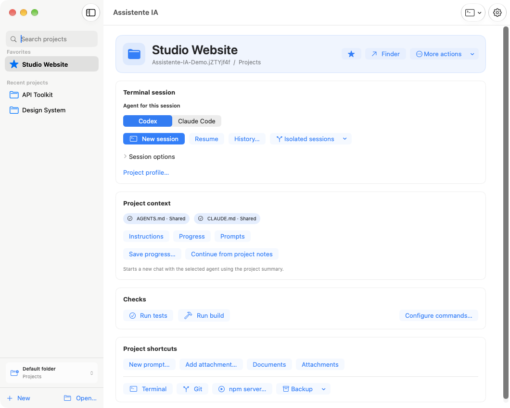
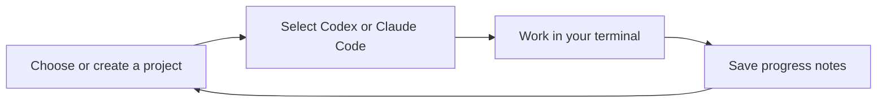
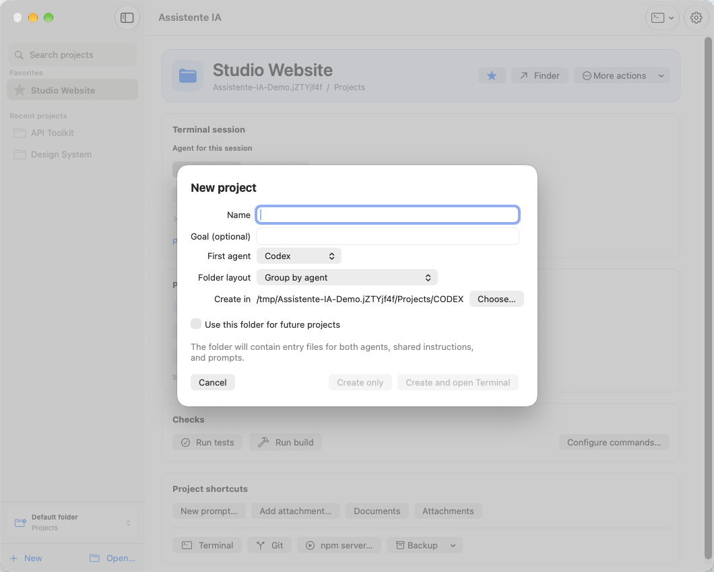
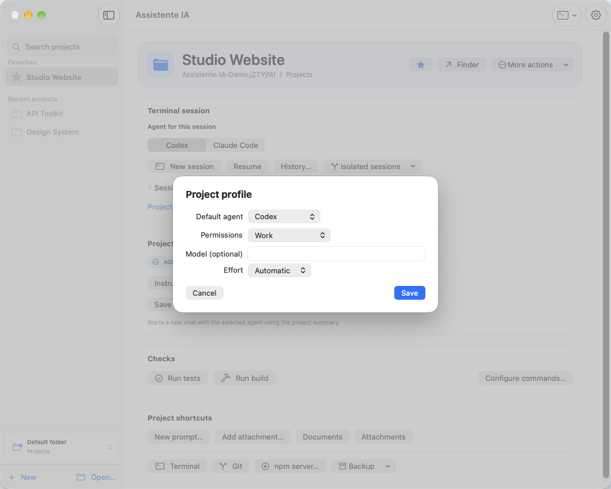
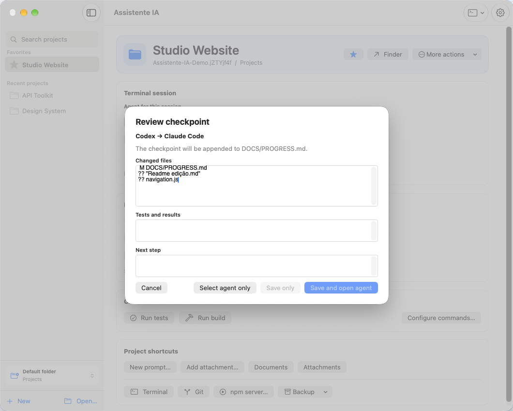
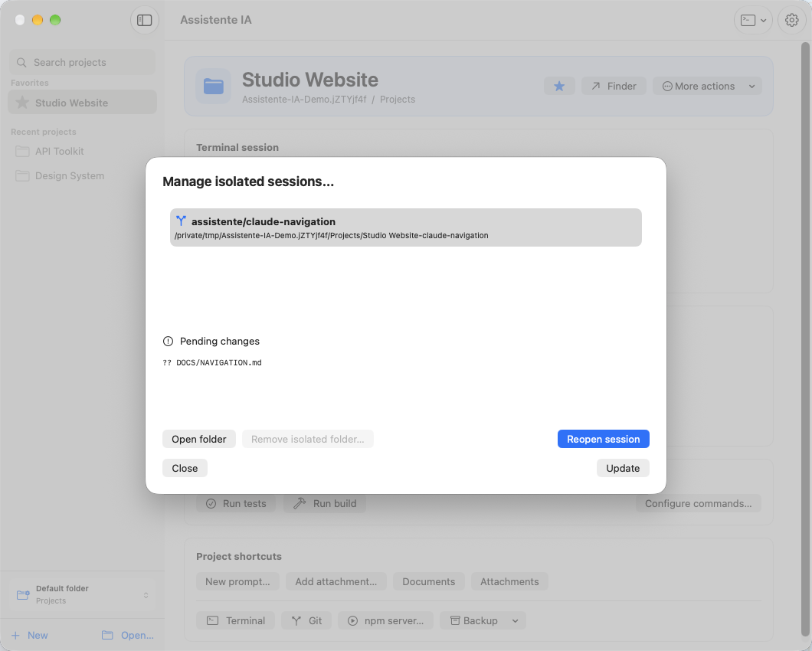
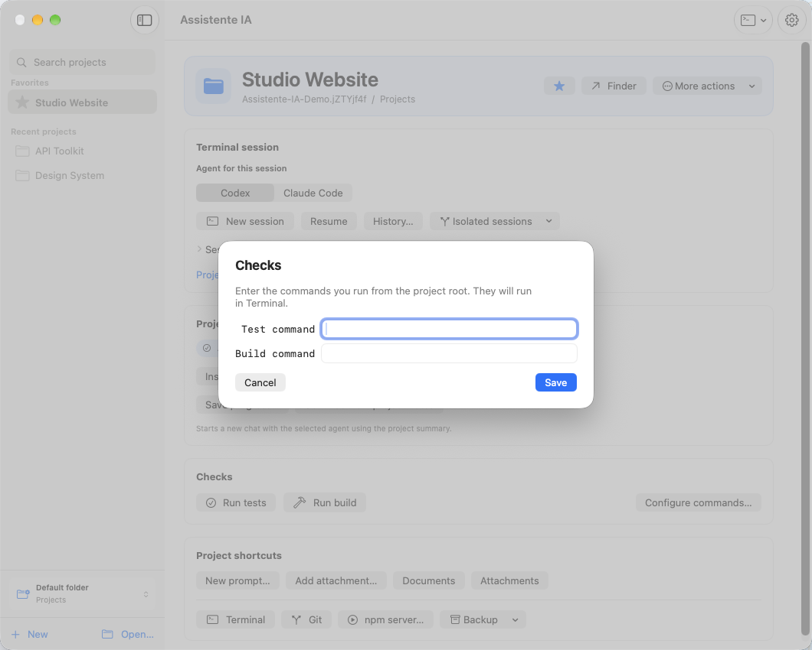
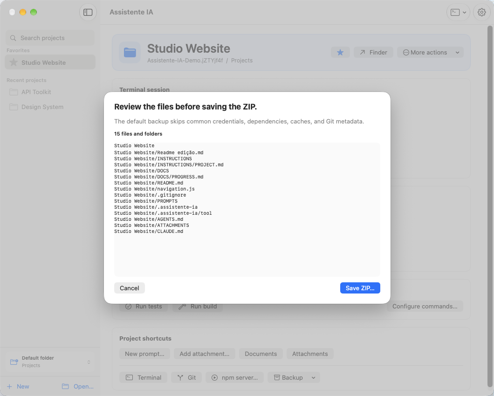

# Codex CLI & Claude Code Workspace

**Assistente IA** is a lightweight project workspace for Codex CLI and Claude Code on macOS, Linux, and Windows. Open either coding agent in your system terminal, hand off progress through shared markdown files, or run both in parallel using Git worktrees. Pin project folders, save per-agent profiles, and run your test and build commands from the same panel.



[](https://github.com/Anglersondev/Codex-CLI-Claude-Code-Workspace/releases/latest) [](LICENSE)

**[Download the latest release](https://github.com/Anglersondev/Codex-CLI-Claude-Code-Workspace/releases/latest)** · [Português (Brasil)](README.pt-BR.md) · [Español](README.es.md) · [Changelog](CHANGELOG.md)

[Install](#download-and-install) · [Quick start](#quick-start) · [Shared context](#share-project-context-between-codex-and-claude-code) · [Screenshots](#macos-app-screenshots) · [Build from source](#build-and-verify-from-source)

## Download and install

| Platform | Download | Requirements and first launch |
| --- | --- | --- |
| **macOS** | [Assistente IA for Mac](https://github.com/Anglersondev/Codex-CLI-Claude-Code-Workspace/releases/latest/download/Assistente-IA-App-macOS.zip) | macOS 13 or later. Extract the ZIP and open `Assistente IA.app`. The universal build includes Apple Silicon and Intel binaries. |
| **Linux** | [Assistente IA for Linux](https://github.com/Anglersondev/Codex-CLI-Claude-Code-Workspace/releases/latest/download/Assistente-IA-App-Linux.zip) | Python 3.9+ with Tkinter and a graphical terminal such as GNOME Terminal, Konsole, or xterm. From the extracted folder, run `sh ASSISTENTE-IA-LINUX-GUI.sh`. |
| **Windows** | [Assistente IA for Windows](https://github.com/Anglersondev/Codex-CLI-Claude-Code-Workspace/releases/latest/download/Assistente-IA-App-Windows.zip) | Windows 10 or 11 with Python 3.9+ and Tcl/Tk. Extract the ZIP and double-click `ASSISTENTE-IA-WINDOWS-GUI.cmd`. |
| **Source code** | [Source ZIP](https://github.com/Anglersondev/Codex-CLI-Claude-Code-Workspace/releases/latest/download/Assistente-IA-Source.zip) | Includes the desktop and terminal launchers, source files, tests, build scripts, and MIT license. |

Install and sign in to [Codex CLI](https://learn.chatgpt.com/docs/cli) or [Claude Code](https://code.claude.com/docs/en/setup) separately. On Debian or Ubuntu, the Tkinter package is `python3-tk`. On Windows, the [official Python installer](https://www.python.org/downloads/windows/) includes a Tcl/Tk option.

The downloadable Mac app uses an ad hoc code signature. If macOS blocks that build, use the terminal launcher or [build the app locally](#build-and-verify-from-source).

## Quick start

1. Click **Default folder** in the sidebar and pick where to keep new projects.
2. Click **New**, choose the first agent, and pick a folder layout. **Group by agent** uses `CODEX/` or `CLAUDE/`. **Create directly in the selected folder** creates only the project folder. Use **Open** for existing projects.
3. Choose **Codex** or **Claude Code**. Click **New session**, **Resume**, or **History**.
4. Work in the agent's official terminal interface. End the session to return to the project panel.

Select **Agent for this session** whenever you want to switch between Codex and Claude in the same project. The folder layout only controls where new projects are created. Selecting the other agent opens a checkpoint for review.

Use **Settings → Language** to choose English, Brazilian Portuguese, Spanish, or **Automatic** to follow your system. Use **Session options** to pick a model, select a starting prompt, or open a read-only planning session.



## Environment checks, agent handoffs and parallel sessions

| To… | Open… | What happens |
|---|---|---|
| Check whether your tools are ready | **Settings → Environment check** | Shows versions for Codex CLI, Claude Code, Git, npm and RTK, checks both agent logins, and suggests a fix for failed checks. Token Optimizer has separate entries for each agent’s plugin setting and cached version. |
| Hand off a task between agents | **Agent for this session → the other agent** | Review the Git change list, record the tests you ran and enter the next step. **Save and open agent** appends your checkpoint to `DOCS/PROGRESS.md` and opens the other agent in the same folder with a request to read it. **Save only** keeps the current agent selected. **Select agent only** skips the checkpoint. |
| Run both agents at once | From the repository root, **Isolated session…** | Choose an agent and a short task name. The panel creates a branch and a sibling working folder. Keep the first terminal open while you work in the second copy. |

For a project called `shop` and a Claude task called `search`, the folder is `shop-claude-search` and the branch is `assistente/claude-search`. The copy starts at the current commit. Commit any local changes you want to include, including instructions and notes. Both folders remain available in recent projects. Review the branch and merge through Git when ready.

Checkpoints also work without Git. Describe your changes in the editable field. The panel lists up to 80 files and records the test results you enter.

## Manage a coding project from the panel

- **Project profiles and favorites.** Use **Project profile** to save the default agent and each agent’s model and permission mode. Click the star to pin a project, then search by name or path.
- **Test and build commands.** In **Checks**, configure the commands you normally run from the project root. Run them in the terminal and review their exit status in the panel. The latest results prefill the next checkpoint for review.
- **Manage Git worktrees.** Under **Isolated sessions**, open the manager to see the branch, path, and pending files. Reopen a session in its own folder. Removing an idle, clean worktree keeps its branch and commits. The manager also checks ignored files, such as local credentials.
- **Preview and restore backups.** Review the project files before saving a ZIP. The desktop backup skips common credentials, Git metadata, dependencies, and caches. **Restore ZIP** extracts a copy into a new folder at the chosen destination.
- **Version and build updates.** The update check compares versions and uses the build number to distinguish revisions of the same version. macOS can stage a verified update when enabled. Linux and Windows open the release downloads.

### Professional build 3 tools in the Linux and Windows panel

- **Prompt library.** Open **Project tools → Prompt library…** to search 21 ready-made prompts in English, Portuguese and Spanish: audits, bug fixes, security, performance, WordPress, accessibility, tests, production readiness, token savings and a review by the other agent. Copy one into the project's prompts folder or start a session with it. In the macOS and Linux terminal menu, choose option **7** when starting a conversation.
- **Quick actions.** Press `Ctrl+K`, type part of an action name and press Enter.
- **Context audit.** **Project tools → Context audit** checks `AGENTS.md`, `CLAUDE.md`, the project instructions and the progress notes. It reports possible credentials by file and line only, missing references and imports, Codex's 32 KiB default limit, repeated lines and too many checkpoints. Sizes are estimates (bytes ÷ 4), not token counts.
- **Compact old checkpoints.** After you confirm, older checkpoints move to a new file in `DOCS/LEGACY/` and the last three stay in the progress notes.
- **Review by the other agent.** When you switch agents, **Save and request review** records the checkpoint, including decisions and open issues, and opens the other agent in plan mode with a review request. Each review is one click; nothing runs in a loop.
- **Detected commands.** **Checks** suggests test, build and lint commands found in the project's manifest files. Review a suggestion and click **Use** to fill the field. Nothing runs or installs by itself.

The macOS app reaches these tools through its terminal menu in this build. The native buttons are not included yet.

## macOS app screenshots

The screenshots show the English interface with a demo web project. The same workflows are available in Brazilian Portuguese and Spanish.

| Project setup | Project settings |
| --- | --- |
| [](assets/screenshots/macos-create-project.png) | [](assets/screenshots/macos-project-profile.png) |
| Create a project in your chosen folder. | Save the agent, model, and permission mode. |
| [](assets/screenshots/macos-checkpoint.png) | [](assets/screenshots/macos-worktrees.png) |
| Review a checkpoint before switching agents. | Check each isolated worktree before reopening or removing it. |
| [](assets/screenshots/macos-checks.png) | [](assets/screenshots/macos-backup.png) |
| Run your own checks from the project root. | Review the ZIP contents before saving. |

[Create an isolated session](assets/screenshots/macos-create-worktree.png) · [Environment diagnostics](assets/screenshots/macos-diagnostics.png) · [App settings](assets/screenshots/macos-settings.png) · [About Assistente IA](assets/screenshots/macos-about.png)

## Share project context between Codex and Claude Code

Projects created in the desktop panel include both agent entry files. Put the goal, project conventions, and recurring constraints in `INSTRUCTIONS/PROJECT.md`. Both entry files point to that shared document.

```text
my-project/
├── AGENTS.md                    # Codex project instructions
├── CLAUDE.md                    # Claude Code project instructions
├── INSTRUCTIONS/PROJECT.md      # Shared goals and rules
├── DOCS/PROGRESS.md             # Progress, decisions, and next step
├── PROMPTS/                     # Reusable requests
└── ATTACHMENTS/                 # Attachments and supporting files
```

For an existing folder, **Set up shared context** creates missing files and preserves custom instructions. Review custom `AGENTS.md` and `CLAUDE.md` files if you want them to reference the shared document. An `AGENTS.override.md` file takes priority for Codex.

Use **Save session progress** before switching agents or accounts. Once you have a recorded next step, **Continue from project notes** starts a new chat that can use the handoff. Each agent manages its own account and conversation history. Keep frequently used rules short and put occasional references in `DOCS/`.

### Pick the right way to continue

| If you want to… | Use… | What carries over |
| --- | --- | --- |
| Continue your latest chat with the same agent | **Resume** | The agent opens its own latest conversation for this project. |
| Find an older chat | **History** | The selected agent opens its session picker. |
| Switch from Codex to Claude Code or change accounts | **Save session progress**, then **Continue from project notes** | The new session uses files in your project folder, including the summary you saved. |

**What gets saved automatically?** File edits go to the project when the agent makes them. The launcher saves preferences and recent folders. To keep a reusable progress summary, ask the agent to update `DOCS/PROGRESS.md` or choose **Save session progress** and let the agent finish writing. Each agent keeps its own chat history.

### Save and close a session

1. To keep a progress summary, use **More actions → Save progress from the latest session…** on macOS or **Project tools → Save session progress** on Linux and Windows. You can also send this message while the conversation is open:
   > Update `DOCS/PROGRESS.md` with what was done, what was tested, and the next step.
2. Wait for the agent to confirm it saved the summary, then exit the session. If you only want to keep the changes already written to files, you can exit directly.
3. To reopen the latest chat with the same agent, use **Resume** or run the corresponding command from the project folder.

| Agent | Resume the latest chat |
| --- | --- |
| Codex CLI | `codex resume --last` |
| Claude Code | `claude --continue` |

The panel is available in English, Brazilian Portuguese, and Spanish. The selected language determines the folder and template names for new projects, including the reusable prompts. Existing projects keep their original paths. `AGENTS.md` and `CLAUDE.md` use the agents’ standard filenames. The standalone terminal’s Portuguese and English menus also offer Spanish project templates.

### Example: start with Codex and hand off to Claude Code

1. Open your website repository in Assistente IA. Choose **Set up shared context** if the folders are missing.
2. In `INSTRUCTIONS/PROJECT.md`, record conventions that apply to every session. For example, “Use npm and run the build before handing off.”
3. Start a Codex session and implement the change. Before switching, ask Codex to update `DOCS/PROGRESS.md` with the changes, checks, and next step.
4. Select Claude Code and click **Continue from project notes**. Claude starts a new conversation with the saved summary.

A short handoff might look like this:

```markdown
## Done
Updated the mobile navigation in src/components/Nav.tsx.

## Verified
npm run build passed. Keyboard navigation still needs checking.

## Next
Test the menu with Tab and Escape at 390 px, then fix any focus issues.
```

## What the workspace includes

| Feature | How it helps |
| --- | --- |
| **Projects and terminal sessions** | Keep recent folders, choose a default root, open a shell in the selected project, and use the agent's own history picker. |
| **Prompts and attachments** | Write a reusable prompt, choose it as a starting request, and copy reference files into the project. |
| **Git, local development, and backups** | View Git status, launch `npm run dev` for a Node.js project, and save a ZIP copy outside the project. |
| **Accounts** | Sign in or switch accounts using the official CLIs while keeping the selected project open. |
| **Context checks** | See shared instructions and saved progress, and get a prompt to shorten long project rules. |
| **RTK and Token Optimizer** | Prevent double compression of terminal output when RTK is configured. The macOS panel also includes integration controls. |
| **Release updates** | macOS can install verified app updates after you opt in. Linux and Windows can notify you about new releases. |

The desktop backup includes ordinary hidden files unless they match an exclusion. The agent you choose handles authentication, model access, and its own permissions. The launcher uses the CLI's workspace or read-only planning mode and stores its own project preferences locally.

To use the existing terminal menus, open `ASSISTENTE-IA-MAC.command`, `ASSISTENTE-IA-LINUX.sh`, or `ASSISTENTE-IA-WINDOWS.cmd`. See the [terminal workflow guide](GUIA-DE-USO.md), [Linux and Windows panel guide](desktop/LEIA-ME.md), and [RTK integration guide](RTK.md).

## Troubleshooting

| What you see | What to check |
| --- | --- |
| The launch button fails or the agent asks you to sign in | Run `codex --version` or `claude --version` in your terminal, then sign in to that CLI. |
| **Continue from project notes** is unavailable | Record a next step in `DOCS/PROGRESS.md` and check that `PROMPTS/CONTINUE.md` exists. |
| A project already has its own instructions | Review its `AGENTS.md`, `AGENTS.override.md`, or `CLAUDE.md` and link the shared instructions where appropriate. |
| Linux opens no terminal | Install a supported graphical terminal and launch the panel from your desktop session. |
| Windows displays a Python or Tkinter error | Check that Python 3.9+ with Tcl/Tk is installed. |

## Terminal command menu

Open **Terminal commands** in the panel and select a command to copy it. Paste it into your terminal in the project folder.

| Use | Terminal |
| --- | --- |
| Resume the last Codex conversation | `codex resume --last` |
| Resume the last Claude conversation | `claude --continue` |
| View Git status | `git status --short --branch` |
| Start the development server | `npm run dev` |
| View RTK savings | `rtk gain` |

## Build and verify from source

On macOS, install the Apple Command Line Tools and run:

```bash
/bin/bash macOS/build.sh "$PWD/Assistente IA.app"
```

On Linux or Windows, start the portable panel with Python and Tkinter:

```text
python desktop/panel.py
```

Run the Bash suite on macOS or Linux. The portable tests can also run separately on Windows.

```bash
/bin/bash ASSISTENTE-IA-MAC.command --check
python3 -I -m unittest discover -s tests -p 'test_*.py'
/bin/bash tests/test_rtk.sh
```

GitHub Actions runs the tests on every push and pull request, and builds tagged versions into a draft release that you publish yourself. Use the [SHA-256 checksums](https://github.com/Anglersondev/Codex-CLI-Claude-Code-Workspace/releases/latest/download/SHA256SUMS.txt) to verify the downloads. See [Contributing](CONTRIBUTING.md) for the contribution process.

## Author and support

Developed by **Anglerson**. [anglerson.com.br](https://anglerson.com.br) · [Buy me a coffee ☕](https://pixgg.com/Anglerson)

[MIT License](LICENSE)
