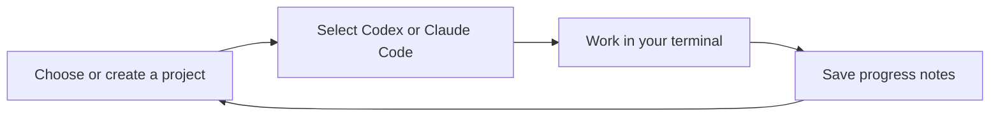

# Codex CLI & Claude Code Workspace

**Assistente IA** is a lightweight desktop launcher for Codex CLI and Claude Code on macOS, Linux, and Windows. Choose a project, pick an agent, and start or resume work in your system terminal. Both agents can use the same project folder, instructions, prompts, and progress notes.

[Download the latest release](https://github.com/Anglersondev/Codex-CLI-Claude-Code-Workspace/releases/latest) · [Português (Brasil)](README.pt-BR.md) · [Español](README.es.md) · [Changelog](CHANGELOG.md)

## Download and install

| Platform | Download | Requirements and first launch |
| --- | --- | --- |
| **macOS** | [Assistente IA for Mac](https://github.com/Anglersondev/Codex-CLI-Claude-Code-Workspace/releases/latest/download/Assistente-IA-App-macOS.zip) | macOS 13 or later. Extract the ZIP and open `Assistente IA.app`. The universal build includes Apple Silicon and Intel binaries. |
| **Linux** | [Assistente IA for Linux](https://github.com/Anglersondev/Codex-CLI-Claude-Code-Workspace/releases/latest/download/Assistente-IA-App-Linux.zip) | Python 3.9+ with Tkinter and a graphical terminal such as GNOME Terminal, Konsole, or xterm. From the extracted folder, run `sh ASSISTENTE-IA-LINUX-GUI.sh`. |
| **Windows** | [Assistente IA for Windows](https://github.com/Anglersondev/Codex-CLI-Claude-Code-Workspace/releases/latest/download/Assistente-IA-App-Windows.zip) | Windows 10 or 11 with Python 3.9+ and Tcl/Tk. Extract the ZIP and double-click `ASSISTENTE-IA-WINDOWS-GUI.cmd`. |
| **Source code** | [Source ZIP](https://github.com/Anglersondev/Codex-CLI-Claude-Code-Workspace/releases/latest/download/Assistente-IA-Source.zip) | Includes the desktop and terminal launchers, source files, tests, build scripts, and MIT license. |

Install and sign in to [Codex CLI](https://learn.chatgpt.com/docs/cli) or [Claude Code](https://code.claude.com/docs/en/setup) separately. On Debian or Ubuntu, the Tkinter package is `python3-tk`. On Windows, the [official Python installer](https://www.python.org/downloads/windows/) includes a Tcl/Tk option.

The downloadable Mac app uses an ad hoc code signature. If macOS blocks that build, use the terminal launcher or [build the app locally](#build-and-verify-from-source).

## Quick start

1. Click **Default folder** in the sidebar and pick where to keep new projects.
2. Click **New** to create a project or **Open** to select an existing folder or Git repository.
3. Choose **Codex** or **Claude Code**. Click **New session**, **Resume**, or **History**.
4. Work in the agent's official terminal interface. End the session to return to the project panel.

Use **Settings → Language** to choose English, Brazilian Portuguese, Spanish, or **Automatic** to follow your system. Use **Session options** to pick a model, select a starting prompt, or open a read-only planning session.



## Share project context between Codex and Claude Code

Projects created in the desktop panel include both agent entry files. Put the goal, project conventions, and recurring constraints in `INSTRUCOES/PROJETO.md`. Both entry files point to that shared document.

```text
my-project/
├── AGENTS.md                 # Codex project instructions
├── CLAUDE.md                 # Claude Code project instructions
├── INSTRUCOES/PROJETO.md      # Shared goals and rules
├── DOCS/ANDAMENTO.md         # Progress, decisions, and next step
├── PROMPTS/                  # Reusable requests
└── ANEXOS/                   # Attachments and supporting files
```

For an existing folder, **Set up shared context** creates missing files and preserves custom instructions. Review custom `AGENTS.md` and `CLAUDE.md` files if you want them to reference the shared document. An `AGENTS.override.md` file takes priority for Codex.

Use **Save session progress** before switching agents or accounts. Once you have a recorded next step, **Continue from project notes** starts a new chat that can use the handoff. Each agent manages its own account and conversation history. Keep frequently used rules short and put occasional references in `DOCS/`.

## What the workspace includes

| Feature | How it helps |
| --- | --- |
| **Projects and terminal sessions** | Keep recent folders, choose a default root, open a shell in the selected project, and use the agent's own history picker. |
| **Prompts and attachments** | Write a reusable prompt, choose it as a starting request, and copy reference files into the project. |
| **Git, local development, and backups** | View Git status, launch `npm run dev` for a Node.js project, and save a ZIP copy outside the project. |
| **Accounts** | Sign in or switch accounts using the official CLIs while keeping the selected project open. |
| **Context checks** | See shared instructions and saved progress, and get a prompt to shorten long project rules. |
| **RTK and Token Optimizer** | Prevent double compression of terminal output when RTK is configured. The macOS panel also includes integration controls. |
| **Release updates** | macOS can install verified app updates after you opt in. Linux and Windows can notify you about new releases. |

Backups can include hidden files. The agent you choose handles authentication, model access, and its own permissions. The launcher uses the CLI's workspace or read-only planning mode and stores its own project preferences locally.

To use the existing terminal menus, open `ASSISTENTE-IA-MAC.command`, `ASSISTENTE-IA-LINUX.sh`, or `ASSISTENTE-IA-WINDOWS.cmd`. See the [terminal workflow guide](GUIA-DE-USO.md), [Linux and Windows panel guide](desktop/LEIA-ME.md), and [RTK integration guide](RTK.md).

## Build and verify from source

On macOS, install the Apple Command Line Tools and run:

```bash
/bin/bash macOS/build.sh "$PWD/Assistente IA.app"
```

On Linux or Windows, start the portable panel with Python and Tkinter:

```text
python desktop/panel.py
```

Run the Bash suite on macOS or Linux. The portable tests can also run separately on Windows.

```bash
/bin/bash ASSISTENTE-IA-MAC.command --check
python3 -I -m unittest discover -s tests -p 'test_*.py'
/bin/bash tests/test_rtk.sh
```

GitHub Actions verifies tagged builds and prepares release assets. Use the [SHA-256 checksums](https://github.com/Anglersondev/Codex-CLI-Claude-Code-Workspace/releases/latest/download/SHA256SUMS.txt) to verify the downloads. See [Contributing](CONTRIBUTING.md) for the contribution process.

## Author and support

Developed by **Anglerson**. [anglerson.com.br](https://anglerson.com.br) · [Buy me a coffee ☕](https://pixgg.com/Anglerson)

[MIT License](LICENSE)
