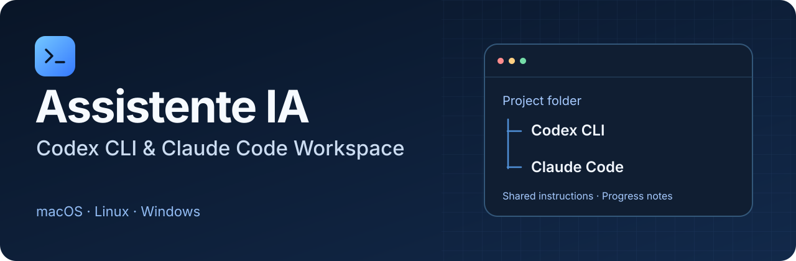

# Workspace para Codex CLI e Claude Code



**Assistente IA** é um painel leve para trabalhar com Codex CLI e Claude Code no macOS, Linux e Windows. Escolha o projeto e o agente no app. A conversa abre no Terminal, na pasta certa. Os dois agentes podem usar as mesmas instruções, os mesmos pedidos reutilizáveis e o mesmo registro de andamento.

[](https://github.com/Anglersondev/Codex-CLI-Claude-Code-Workspace/releases/latest) [](LICENSE)

**[Baixar a versão mais recente](https://github.com/Anglersondev/Codex-CLI-Claude-Code-Workspace/releases/latest)** · [English](README.md) · [Español](README.es.md) · [Histórico de versões](CHANGELOG.md)

[Instalação](#baixar-e-abrir) · [Primeiro projeto](#primeiro-projeto) · [Contexto compartilhado](#contexto-compartilhado-e-andamento) · [Ferramentas](#ferramentas-e-atualizações)

## Baixar e abrir

| Sistema | Download | Como abrir |
| --- | --- | --- |
| **macOS** | [Baixar para Mac](https://github.com/Anglersondev/Codex-CLI-Claude-Code-Workspace/releases/latest/download/Assistente-IA-App-macOS.zip) | macOS 13 ou posterior. Descompacte e abra `Assistente IA.app`. O pacote inclui Apple Silicon e Intel. |
| **Linux** | [Baixar para Linux](https://github.com/Anglersondev/Codex-CLI-Claude-Code-Workspace/releases/latest/download/Assistente-IA-App-Linux.zip) | Com Python 3.9+, Tkinter e um terminal gráfico, execute `sh ASSISTENTE-IA-LINUX-GUI.sh` na pasta descompactada. |
| **Windows** | [Baixar para Windows](https://github.com/Anglersondev/Codex-CLI-Claude-Code-Workspace/releases/latest/download/Assistente-IA-App-Windows.zip) | Com Python 3.9+ e Tcl/Tk, dê dois cliques em `ASSISTENTE-IA-WINDOWS-GUI.cmd` na pasta descompactada. |
| **Código-fonte** | [Baixar o código-fonte](https://github.com/Anglersondev/Codex-CLI-Claude-Code-Workspace/releases/latest/download/Assistente-IA-Source.zip) | Inclui o app, os lançadores de Terminal, os testes e a licença MIT. |

Instale o [Codex CLI](https://learn.chatgpt.com/docs/cli) ou o [Claude Code](https://code.claude.com/docs/en/setup) e entre na sua conta. No Debian ou Ubuntu, use o pacote `python3-tk`. No Windows, o [instalador oficial do Python](https://www.python.org/downloads/windows/) oferece Tcl/Tk.

O app distribuído para Mac usa assinatura ad hoc. Se o macOS bloquear a abertura, use o lançador do Terminal ou [compile localmente](README.md#build-and-verify-from-source).

## Primeiro projeto

1. Clique em **Pasta padrão** na barra lateral para escolher onde guardar projetos novos.
2. Clique em **Novo**, escolha o primeiro agente e a organização das pastas. **Separar por agente** usa `CODEX/` ou `CLAUDE/`. **Criar direto na pasta escolhida** cria só a pasta do projeto. Use **Abrir** para projetos existentes.
3. Selecione **Codex** ou **Claude Code** e clique em **Nova sessão**, **Continuar** ou **Histórico**.
4. Use o Terminal para conversar e trabalhar. Ao encerrar a sessão, o painel volta a ficar disponível.

Em **Agente desta sessão**, escolha Codex ou Claude para trabalhar no mesmo projeto. A organização só define onde o projeto novo será criado. Para levar o contexto ao outro agente, use **Salvar andamento**, troque o agente e clique em **Retomar pelo andamento**.

Em **Ajustes → Idioma**, escolha português do Brasil, inglês, espanhol ou o idioma do sistema. **Opções da sessão** reúne modelo, permissões e pedido inicial.

## Contexto compartilhado e andamento

- **`AGENTS.md` e `CLAUDE.md`** são as entradas de cada agente. Aponte as duas para `INSTRUCOES/PROJETO.md` para compartilhar regras e objetivos.
- **`DOCS/ANDAMENTO.md`** guarda decisões, testes e o próximo passo. Use **Salvar andamento da sessão** antes de trocar de agente ou conta. Depois selecione **Retomar pelo andamento** para começar outro chat com o resumo.
- **`PROMPTS/`** é a pasta dos pedidos que você escolhe reutilizar. **`ANEXOS/`** guarda os arquivos de apoio.
- Em projetos existentes, **Preparar contexto compartilhado** cria os arquivos faltantes e preserva instruções próprias. O painel avisa quando as regras permanentes ficam extensas.

A conta e o histórico ficam com o agente oficial. Em **Ajustes**, você pode trocar de conta e continuar na mesma pasta.

### Qual botão usar para continuar?

| O que você quer fazer | Botão | O que é retomado |
| --- | --- | --- |
| Voltar ao chat mais recente do mesmo agente | **Continuar** | A conversa mais recente daquele agente para o projeto. |
| Procurar uma conversa antiga | **Histórico** | O seletor de conversas do agente. |
| Passar de Codex para Claude ou trocar de conta | **Salvar andamento da sessão** e depois **Retomar pelo andamento** | Uma conversa nova que usa o resumo na pasta do projeto. |

**O que salva sozinho?** O agente grava na pasta as alterações que faz nos arquivos, e o Assistente guarda os projetos recentes e as preferências. Para manter um resumo do trabalho, use **Salvar andamento da sessão** e deixe o agente concluir a gravação, ou peça durante a conversa para atualizar `DOCS/ANDAMENTO.md`. O histórico da conversa fica com o agente.

### Como salvar o andamento antes de fechar

1. Para guardar o resumo, use **Mais ações → Salvar andamento da última sessão…** no macOS ou **Ferramentas do projeto → Salvar andamento da sessão** no Linux e Windows. Se estiver com a conversa aberta, também pode enviar esta frase:
   > Atualize `DOCS/ANDAMENTO.md` com o que foi feito, o que foi testado e o próximo passo.
2. Espere a IA confirmar que salvou o resumo e encerre a sessão. Se quiser apenas manter as alterações já gravadas nos arquivos, pode fechar direto.
3. Para voltar ao mesmo chat, use **Continuar** ou execute o comando do seu agente no Terminal, dentro da pasta do projeto.

| Agente | Retomar a última conversa |
| --- | --- |
| Codex CLI | `codex resume --last` |
| Claude Code | `claude --continue` |

O painel e os READMEs têm versões em português do Brasil, inglês e espanhol. Os menus de Terminal têm opções em português do Brasil e inglês. Os comandos do Codex e do Claude são iguais em qualquer idioma.

| Nome na pasta | Para que serve |
| --- | --- |
| `CODEX/` e `CLAUDE/` | Pastas dos agentes dentro da pasta padrão. |
| `INSTRUCOES/` | Regras e objetivos compartilhados do projeto. |
| `DOCS/ANDAMENTO.md` | Resumo do que foi feito, testado e do próximo passo. |
| `PROMPTS/` | Pedidos reutilizáveis. |
| `ANEXOS/` | Arquivos de apoio. |

Esses nomes são os mesmos no disco até com o painel em inglês ou espanhol. Assim, os agentes encontram os arquivos pelos mesmos caminhos.

### Exemplo: começar no Codex e passar para Claude Code

1. Abra a pasta do site no Assistente. Se faltarem arquivos de contexto, clique em **Preparar contexto compartilhado**.
2. Em `INSTRUCOES/PROJETO.md`, anote regras que valem para todo o projeto, como “Use npm e rode o build antes de passar a tarefa adiante”.
3. Abra o Codex e faça a alteração. Antes de trocar, peça para atualizar `DOCS/ANDAMENTO.md` com o que mudou, o que foi testado e o próximo passo.
4. Selecione Claude Code e clique em **Retomar pelo andamento**. O Claude abre uma conversa nova usando o resumo.

Exemplo de resumo curto:

```markdown
## Feito
Atualizei o menu mobile em src/components/Nav.tsx.

## Verificado
npm run build passou. Falta testar a navegação pelo teclado.

## Próximo passo
Testar Tab e Esc no menu com a tela em 390 px e corrigir o foco se necessário.
```

## Ferramentas e atualizações

O painel tem atalhos para criar pedidos, adicionar anexos, abrir o Terminal, ver o status do Git, iniciar `npm run dev` e criar uma cópia ZIP. Use **Comandos do Terminal** para copiar os comandos dos agentes e das ferramentas. A cópia ZIP pode incluir arquivos ocultos.

Quando o RTK está configurado, o Assistente pode evitar a compactação duplicada de saída com o Token Optimizer. O Mac oferece controles das integrações e instalação opcional de atualizações verificadas. Linux e Windows podem avisar quando houver novas versões publicadas.

Os menus completos de Terminal estão nos arquivos `ASSISTENTE-IA-MAC.command`, `ASSISTENTE-IA-LINUX.sh` e `ASSISTENTE-IA-WINDOWS.cmd`. Consulte o [guia de Terminal](GUIA-DE-USO.md), o [guia para Linux e Windows](desktop/LEIA-ME.md), a [documentação do RTK](RTK.md) e o [histórico de versões](CHANGELOG.md).

## Menu de comandos do Terminal

Abra **Comandos do Terminal** no painel, selecione um comando para copiar e cole no Terminal dentro da pasta do projeto.

| Ação | Terminal |
| --- | --- |
| Retomar a última conversa do Codex | `codex resume --last` |
| Retomar a última conversa do Claude | `claude --continue` |
| Ver status do Git | `git status --short --branch` |
| Iniciar o servidor de desenvolvimento | `npm run dev` |
| Ver a economia do RTK | `rtk gain` |

## Se algo não abrir

| Sintoma | O que conferir |
| --- | --- |
| O agente não abre ou pede login | Rode `codex --version` ou `claude --version` no Terminal e entre na conta daquela ferramenta. |
| **Retomar pelo andamento** está desabilitado | Registre o próximo passo em `DOCS/ANDAMENTO.md` e confira se existe `PROMPTS/CONTINUAR.md`. |
| O projeto já tem regras próprias | Confira `AGENTS.md`, `AGENTS.override.md` ou `CLAUDE.md` e adicione a referência às regras compartilhadas onde fizer sentido. |
| O painel abre, mas o Linux não inicia a sessão | Use um terminal gráfico compatível, como GNOME Terminal, Konsole ou xterm. |
| O Windows mostra erro de Python ou Tkinter | Confira se o Python 3.9+ foi instalado com Tcl/Tk. |

## Autor e apoio

Desenvolvido por **Anglerson**. [anglerson.com.br](https://anglerson.com.br) · [Pague um café ☕](https://pixgg.com/Anglerson)

[Licença MIT](LICENSE)
